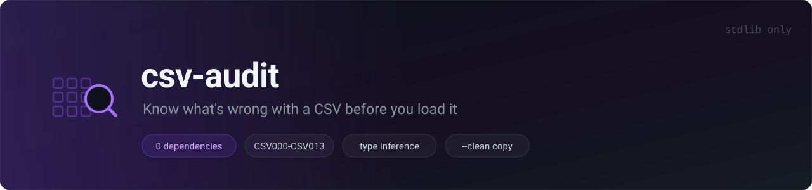
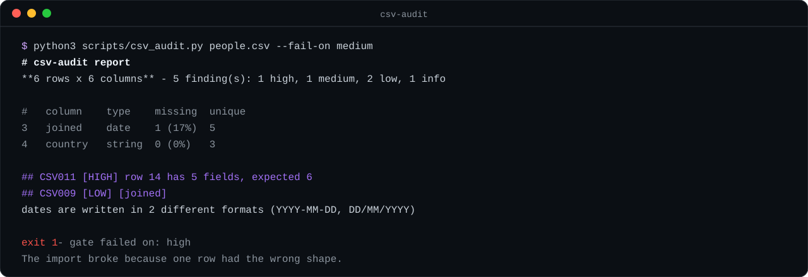

# csv-audit



[](#tests)
[](#)
[](#)
[](LICENSE)

**Know what's wrong with a CSV before you load it.**

Point it at a file; it profiles every column and reports the concrete, checkable problems — ragged rows, mixed types, five spellings of "missing", dates that disagree with each other, stray whitespace, outliers — each with the column it's in and a fix. No dependencies, no silent edits, just an honest diagnosis.

> This is a [Claude / Agent Skill](https://claude.com/docs): a `SKILL.md` file plus helper scripts that an AI agent can load and run. Drop the folder into your skills directory and ask "what's wrong with this CSV before I import it?"



## Why

Most "the import broke" bugs are one of a handful of things: a row with the wrong number of fields, a column that isn't as numeric as it looks, or `""` and `N/A` and `-` all meaning "missing" in the same file. `csv-audit` finds those in one deterministic pass, on a single file, before they reach your pipeline.

## Quick start

```bash
# profile a file
python3 scripts/csv_audit.py data.csv

# machine-readable, for a pipeline
python3 scripts/csv_audit.py data.csv --format json

# fail a build on anything medium or worse
python3 scripts/csv_audit.py data.csv --fail-on medium

# write a cleaned copy (trimmed + normalized nulls), and de-duplicate
python3 scripts/csv_audit.py data.csv --clean clean.csv --dedupe

# a file with a pipe delimiter and no header row
python3 scripts/csv_audit.py data.psv --delimiter '|' --no-header

# sample a huge file quickly
python3 scripts/csv_audit.py big.csv --max-rows 50000
```

Standard library only (Python 3.8+). No `pip install`. The delimiter is sniffed (`.tsv` uses tab) unless you pass `--delimiter`.

## Rules

| Rule | Severity | Meaning |
|------|----------|---------|
| CSV011 | high | Row has a field count different from the header |
| CSV001 | medium | Duplicate or empty column name |
| CSV003 | medium | Column is mostly (or entirely) empty |
| CSV004 | medium | Duplicate rows |
| CSV005 | medium | Column mixes numeric and non-numeric values |
| CSV006 | low | Missing values use several different spellings |
| CSV007 | low | Numeric values outside the IQR fence |
| CSV008 | low | Leading/trailing whitespace |
| CSV009 | low | More than one date format in a column |
| CSV013 | low | Values differ only by letter case |
| CSV002 | info | Column has a single value |
| CSV010 | info | Every value is unique — looks like an ID column |
| CSV012 | info | File starts with a UTF-8 BOM |
| CSV000 | info | File has no rows |

Nulls are recognized across common spellings (`""`, `N/A`, `NULL`, `-`, `?`, `NaN`, …). Inferred types: `int`, `float`, `bool`, `date` (several formats), `string`, `mixed`, `null`. Blank lines are ignored rather than counted as malformed rows.

## Output and exit codes

- **markdown** (default): file name, row×column counts, a severity tally, a per-column profile table (type / missing / unique / range), then one section per finding.
- **json**: `{tool, version, file, summary, columns[], findings[]}` — stable shape for a pipeline.

Exit codes: `0` clean or below `--fail-on`; `1` a finding at or above `--fail-on`; `2` usage/IO error.

## Scopes it on purpose

`csv-audit` profiles and describes; it does not decide what your data means. Without `--clean` it writes nothing. With `--clean` it only trims whitespace, normalizes null spellings to empty, and (optionally) drops exact duplicate rows — **nothing semantic**. It does not join, transform, or merge datasets, and it does not infer business meaning. Outliers use a plain IQR fence reported as-is: that is arithmetic, not a statistical test. See `SKILL.md` → *Guardrails*.

## CI

```yaml
- run: python3 scripts/csv_audit.py data/export.csv --fail-on medium
```

## Tests

```bash
python3 -m unittest discover -s tests      # zero-dependency
# or:  pytest tests/
```

30 tests covering type inference, every rule, delimiter sniffing, header-less mode, the `--clean` round-trip (quoted commas and embedded newlines survive), blank-line handling, and the CLI contract (exit codes, `--ignore`, `--fail-on`, JSON shape). Everything runs offline against temporary fixtures.

## Repo layout

```
SKILL.md                       # the skill: when to use, how, guardrails
scripts/csv_audit.py           # the profiler (stdlib only)
tests/test_csv_audit.py        # unittest suite (offline)
assets/                        # banner + demo (SVG)
CHANGELOG.md
.github/workflows/ci.yml       # tests on 3.9 / 3.11 / 3.12
```

## 中文简介

`csv-audit` 是一个 Agent Skill：对单个 CSV/TSV 做数据质量剖析，报出**具体可查**的问题——ragged 行（字段数不对）、重复/空表头、缺失列、重复行、列内混合类型、null 的多种写法、同列多种日期格式、前后空格、大小写不一致、IQR 离群值、像 ID 的高基数列。可选 `--clean` 输出一份处理过的副本（只做 trim、null 归一、可选去重，**绝不语义改写**）。只用 Python 标准库，零依赖。把文件夹放进你的 skills 目录，然后问 agent"导入前这个 CSV 有什么问题"即可。

## License

MIT
